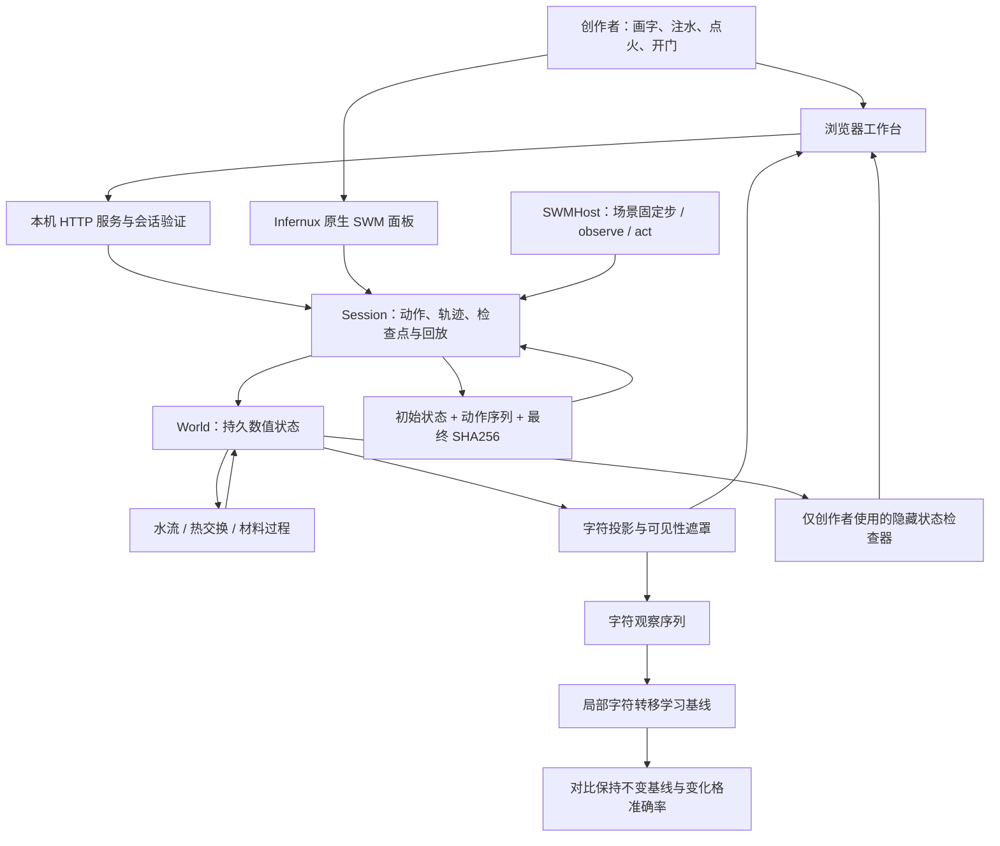
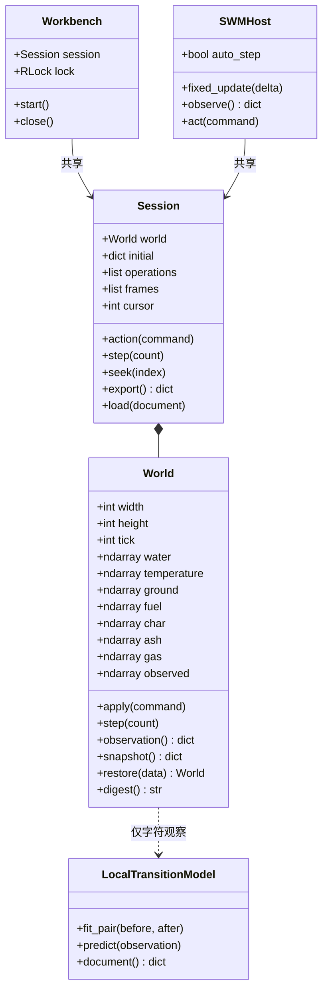
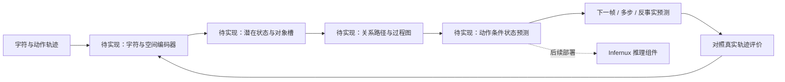

# 汉字语义世界：定制框架

设计原则是把「真实状态」「字符观察」「学习器」分开。水增加时可以仍显示同一个「水」字；观察被逗号遮蔽时，底层过程仍继续。学习器通过观察序列估计状态和规律，参考模拟器提供可重复的实验与评价标准。

## 当前可运行结构

核心不依赖引擎，可独立运行与测试；插件把同一核心接入 Infernux 的生命周期、面板和组件系统。编辑器与浏览器共享一份 Session 和锁。网页、HTTP 服务和训练工具仅用于创作；Runtime 角色只承载世界核心与宿主。

## 核心类型关系

## 对接 3N 的下一阶段

上游的 3N（Neural Network-Native）是发展方向。本版先落实可行动、可观察、可复现实验的数据闭环；没有把路线图功能当成已完成的能力。

建议先做三个对照实验：同一字符外观、不同隐藏水量的未来预测；改变含水率和供氧后材料过程的预测；开关门后人物可达性的预测。先用分场景、分初始条件的数据划分，避免训练与测试轨迹泄漏，再研究神经状态表示和关系发现。

当前局部频数模型只验证训练管线。其变化格预测准确率为 0；高总体准确率主要来自静止格，不能证明模型学到了世界规律。

参考模拟器也有明确边界：燃料来源示踪量守恒不等于完整化学质量守恒；温度规则不构成能量守恒模型；房间识别来自显式几何算法。
